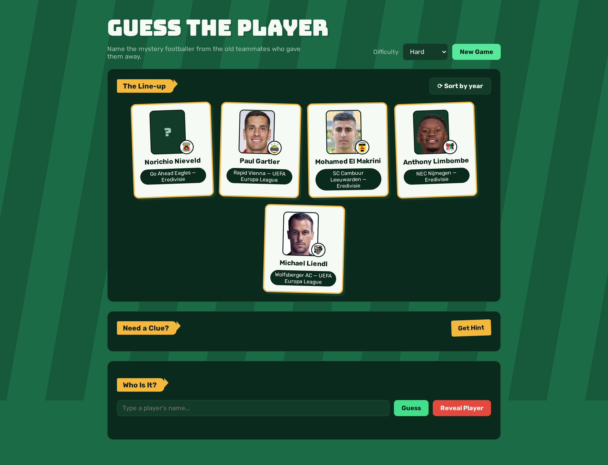
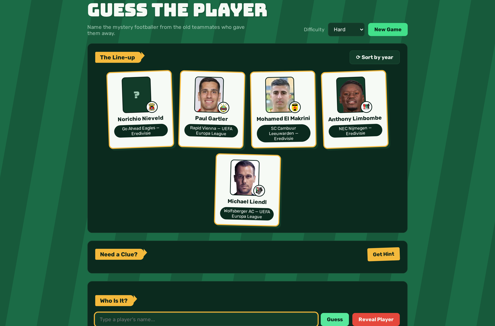
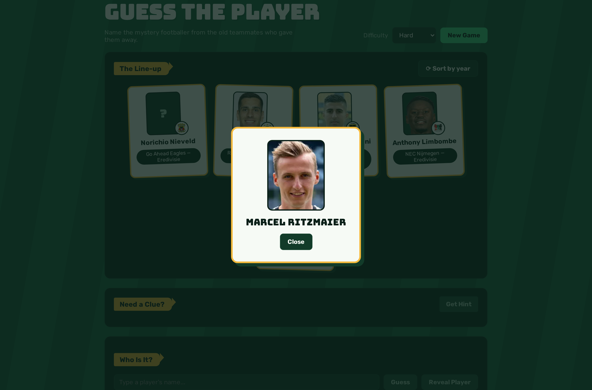
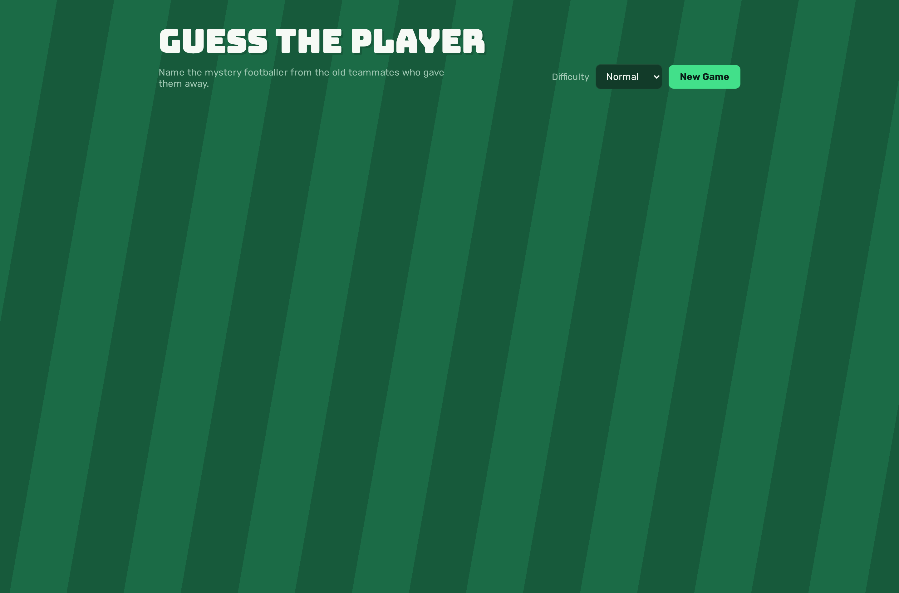

# Footy Quiz — Guess the Player

<p align="center">
  
</p>

A football quiz game. The current mode, **Guess the Player**, identifies a mystery
footballer only through a chain of deterministic clues — "played alongside teammate A at
Club X" — built from [transfermarkt-datasets](https://github.com/dcaribou/transfermarkt-datasets)
(CC0): top-flight domestic leagues worldwide plus World Cup/Euro/Copa América/AFCON/Asian
Cup/Champions League/Europa League, 2005-2025. On top of that, players can request hints: a
live RAG pipeline retrieves grounded, non-spoiler sentences from the mystery player's
Wikipedia page and has an LLM (Claude Haiku 4.5) phrase them into a natural trivia hint.

**Stack:** Python 3.12 · FastAPI · DuckDB · LangChain embeddings + sentence-transformers · Claude Haiku 4.5 · vanilla JS frontend

## Screenshots

### The Line-up — deterministic teammate clues


### Guessing (with feedback)



### Reveal — the mystery player



### Landing



## Prerequisites

- [uv](https://docs.astral.sh/uv/) (manages the Python version and virtualenv)
- An [Anthropic API key](https://console.anthropic.com/) (for hint phrasing)

## Setup

```bash
# 1. Create the virtualenv (pinned to Python 3.12) and install dependencies
uv venv --python 3.12
uv sync

# 2. Vendor the transfermarkt-datasets DuckDB file (~210 MB, already-built, no
#    JSON/CSV parsing needed)
./scripts/vendor_transfermarkt.sh

# 3. Build the database: ingests the vendored file, then builds the
#    co-appearance ("teammate") graph on top of it
uv run scripts/build_db.py
uv run scripts/build_graph.py

# 4. Add your Anthropic API key
cp env.example .env
# then edit .env and set ANTHROPIC_API_KEY=sk-ant-...

# 5. Link each player to their exact Wikipedia article via Wikidata's Transfermarkt id
#    (~30 min the first time, cached afterwards). Hints and fame both need it.
uv run scripts/build_wiki_links.py

# 6. Pre-compute real-world fame (Wikipedia pageviews) for every structurally
#    easy/normal candidate, so "easy"/"normal" favor actually-recognizable players over
#    just well-logged ones. Without it, everyone bands into "hard"/"extreme".
uv run scripts/build_popularity.py
```

## Running

```bash
uv run uvicorn footy_quiz.api.main:app --reload
```

Open **http://127.0.0.1:8000** in a browser.

The first hint request for any given player fetches and embeds their Wikipedia page
(a network call plus a one-time local model load), so the very first hint in a fresh run
is slower than the rest — later hints for the same player, and hints for other players
you've already seen, are fast. Club crests and most player photos come directly from the
vendored data; the small minority with only a placeholder there use their Wikidata photo.

## Running the tests

```bash
uv run pytest
```

Most tests need the database built (step 3 above); they skip themselves if it's missing.
A handful make real network calls (Wikipedia resolution) on first run per player and are
cached afterward.

## Project layout

```
footy_quiz/                # riddle engine + RAG hint pipeline (the actual game logic)
  hints/                   # Wikipedia fetch/chunk/embed/retrieve, session state, LLM phrasing
  api/                     # FastAPI service
vendor/transfermarkt/      # vendored transfermarkt-datasets DuckDB file (gitignored,
                            # re-fetched via vendor_transfermarkt.sh)
data/                      # the built DuckDB file (gitignored, rebuildable from scripts/)
web/                       # static frontend (no build step)
scripts/                   # one-off build/debug/verification scripts
tests/
```
